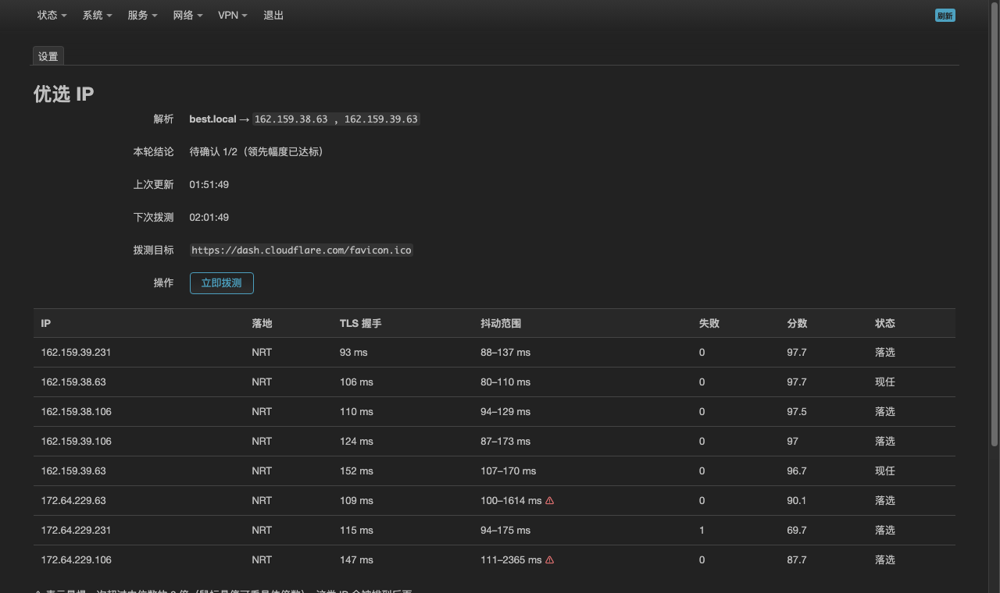
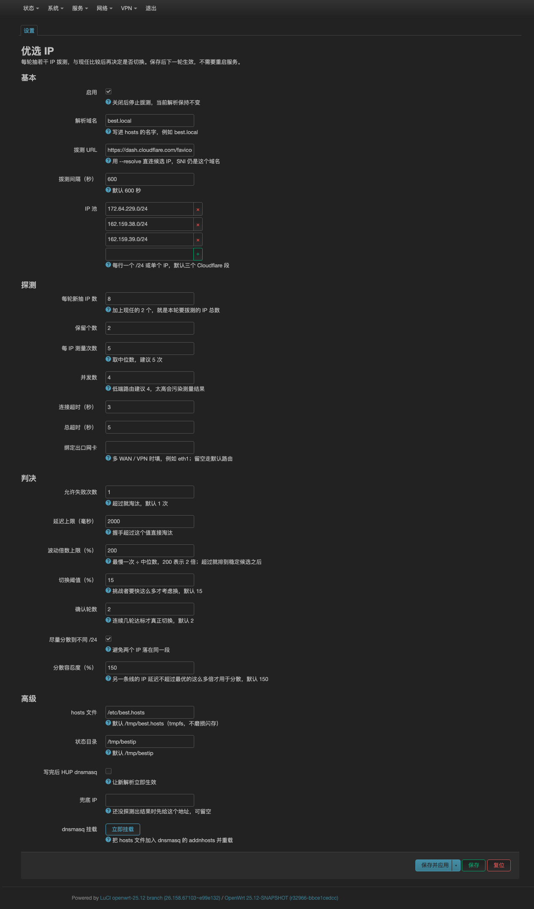

# luci-app-bestip

OpenWrt 上的「Cloudflare 优选 IP」小工具：定时从 IP 池里抽样拨测，把**最快且稳定**的 2 个写进 dnsmasq 的 hosts，并带一个 LuCI 看板。

默认参数就是按「每次 10 个候选、留最优 2 个、10 分钟一轮、写入 `best.local`」配好的。

## 截图





## 一轮发生了什么

1. 从 3 个 `/24` 池里**按比例随机抽 8 个**新 IP；
2. 加上**现任 2 个**，共 10 个候选（这样现任有资格"卫冕"，不会每轮都被随机换掉）；
3. 每个 IP 用 `curl --resolve` 直连 `https://dash.cloudflare.com/favicon.ico`，**测 5 次取中位数**（交错顺序，同一时间窗，避免网络波动被误判成 IP 差异）；
4. 门槛：失败 ≤ 1 次、握手 ≤ 2000ms、波动 ≤ 2 倍（最慢一次 ÷ 中位数）；
5. 按「握手时间中位数 → 首字节」排序，取前 2，尽量来自不同 `/24`；
6. **滞回**：挑战者要比现任快 15% 以上，且连续 2 轮达标，才真正切换；
7. 写入 `/etc/best.hosts`，`killall -HUP dnsmasq` 让解析立即生效，并记录一轮历史。

选择把手握手时间（`time_appconnect`）而不是总耗时作为主指标，是因为 favicon 只有几百字节，总耗时里混进了缓存命中和下载噪声，握手时间更接近"纯网络质量"。

## 目录

```
luci-app-bestip/
├── Makefile
├── htdocs/luci-static/resources/view/bestip/
│   ├── overview.js          # 看板
│   └── settings.js          # 设置
├── root/
│   ├── etc/config/bestip            # UCI 默认值
│   ├── etc/init.d/bestip            # procd 服务
│   ├── usr/sbin/bestip              # 引擎（独立可跑，不依赖 LuCI）
│   ├── usr/libexec/rpcd/bestip      # ubus 后端
│   └── usr/share/{luci,rpcd}/...    # 菜单与 ACL
└── tools/local-test.sh              # 在 Linux/macOS 上免路由器试跑
```

引擎和 LuCI 是分开的：就算 LuCI 挂了、没装、或者你只想用命令行，`bestip run --force` 照样工作。

## 安装

### 方式 A：直接铺文件（调试最快）

```sh
# 在路由器上
scp -r root/*    root@192.168.1.1:/
scp -r htdocs/*  root@192.168.1.1:/www/
ssh root@192.168.1.1
chmod +x /usr/sbin/bestip /usr/libexec/rpcd/bestip /etc/init.d/bestip
/etc/init.d/rpcd restart
/etc/init.d/bestip enable
/etc/init.d/bestip start
/usr/sbin/bestip setup        # 把 /etc/best.hosts 挂到 dnsmasq
```

然后访问 `http://192.168.1.1/cgi-bin/luci/admin/services/bestip`。

### 方式 B：SDK 打包

```sh
cd openwrt-sdk-*
cp -r luci-app-bestip feeds/luci/applications/
make menuconfig          # LuCI → Applications → luci-app-bestip
make package/luci-app-bestip/compile V=s
```

产物在 `bin/packages/*/luci/`。

### 兼容性

| 版本 | 包管理 | 产物 | 说明 |
|---|---|---|---|
| **24.10.x** | opkg | `.ipk` | 目标版本，LuCI 接口已按 24.10 分支源码核对 |
| 25.12 / snapshot | apk | `.apk` | 同一份源码，换对应 SDK 出包 |
| 22.03 ~ 23.05 | opkg | `.ipk` | JS LuCI 接口一致，理论可用，未验证 |

- 用到的 LuCI 接口：`form.Map` / `TypedSection` / `Value` / `DynamicList` / `Flag` / `Button`、`dom.parse`、`dom.content`、`poll.add`、`ui.addNotification`、`rpc.declare`、`view.extend` —— 24.10 的 `modules/luci-base` 里这些都在。
- 直接铺文件的方式（方式 A）两个版本完全一样，跟包管理器无关。
- 引擎只依赖 BusyBox 自带工具：`awk`、`sort`、`od`、`seq`、`tr`、`sed`，外加 `curl`。
- 安装依赖：24.10 用 `opkg install curl ca-bundle`，25.12 用 `apk add curl ca-bundle`。`luci-base` 已写进 `LUCI_DEPENDS`。

### 依赖

`curl`（要支持 `--resolve`，OpenWrt 包里的都支持）、`ca-bundle`。BusyBox 的 `wget` 干不了这事。

## 配置

LuCI → 服务 → 优选 IP → 设置，或者直接改 `/etc/config/bestip`。**保存后下一轮生效，不用重启服务。**

| 键 | 默认 | 说明 |
|---|---|---|
| `enabled` | 1 | 总开关，关掉只停止拨测，现有解析不动 |
| `hostname` | `best.local` | 写进 hosts 的名字 |
| `target` | `https://dash.cloudflare.com/favicon.ico` | 拨测 URL |
| `interval` | 600 | 两轮间隔（秒） |
| `pool` | 3 个 Cloudflare `/24` | 每行一个 `/24` 或单个 IP |
| `sample_new` | 8 | 每轮新抽几个（+2 现任 = 10） |
| `keep` | 2 | 保留几个 |
| `rounds` | 5 | 每个 IP 测几次 |
| `concurrency` | 4 | 并发拨测数 |
| `connect_timeout` / `max_time` | 3 / 5 | 秒 |
| `max_fails` | 1 | 失败超过就淘汰 |
| `max_latency_ms` | 2000 | 握手超过就淘汰 |
| `spread_max_pct` | 200 | 波动倍数上限：最慢一次 ÷ 中位数，超过就排到稳定候选之后 |
| `switch_margin` | 15 | 挑战者要快多少 % 才考虑换 |
| `confirm_rounds` | 2 | 连续几轮达标才换 |
| `prefer_distinct_pool` | 1 | 2 个 IP 尽量不同 `/24` |
| `distinct_factor` | 150 | 为分散而选另一条线时，延迟最多是最优的 1.5 倍 |
| `dnsmasq_reload` | 1 | 写完是否 HUP dnsmasq |
| `hosts_file` / `state_dir` | `/etc/best.hosts` / `/tmp/bestip` | hosts 只在一组 IP 变化时才写，放 /etc 保证重启后 dnsmasq 启动就能加载 |
| `interface` | 空 | 多 WAN / VPN 时绑出口，如 `eth1` |
| `fallback_ip` | 空 | 首次运行前的兜底地址 |

## 命令行

```sh
bestip run --force      # 立刻跑一轮（忽略 enabled）
bestip run --loop       # 常驻循环（init 脚本就是用它）
bestip status           # JSON 状态
bestip history 24       # 最近 24 轮
bestip show             # 人类可读的最近一轮
bestip log 30           # 最近 30 条运行日志
bestip setup|unsetup    # 挂载 / 摘除 dnsmasq addnhosts
```

## 排障

```sh
bestip show                       # 本轮候选、延迟、抖动、分数
bestip log 30                     # 每轮的"切换/保持"结论（也写一份到 /tmp/bestip/bestip.log）
ubus call bestip status           # 和看板同一份数据
cat /etc/best.hosts               # 实际写出的两条记录
nslookup best.local 127.0.0.1     # dnsmasq 是否真的生效
```

常见情况：

- **一直是"保持"**：说明挑战者没有连续 2 轮领先 15%。想更激进就把 `switch_margin` 调到 5~10。
- **一直"淘汰"**：看 `max_fails` / `max_latency_ms` 是否太严；也可能是路由器到 CF 的线路本身很差。
- **看板上没数据**：`/etc/init.d/rpcd restart` 一次，或确认 `/usr/libexec/rpcd/bestip` 有执行权限。
- **解析不生效**：`bestip setup` 没跑，或 `dnsmasq_reload` 被关了。注意新增 `addn-hosts` 选项必须重启 dnsmasq，`setup` 已经处理；之后每次换 IP 只用 HUP。

## 注意

- **`.local` 是 mDNS 保留后缀**：macOS/iOS/Avahi 可能先发 mDNS 查询而绕过 dnsmasq。建议改成 `best.lan` 或 `best.internal`，改 `hostname` 一项即可。
- 双 A 记录**不等于**客户端会用快的那个，浏览器通常固定用第一条或轮询。要"必用最优"，就把 `keep` 改成 1。
- 只对走这台 dnsmasq 的客户端有效；DoH/DoT、自带 DNS 的 App 不受影响。
- 池里全是 Cloudflare 任播地址，通常差异只有几毫秒到几十毫秒——这个工具的价值是**避开绕路/抖动的个别 IP**，不是提速一个数量级。
- 解析记录放 `/etc/best.hosts`，重启后 dnsmasq 启动时就能读到上一组 IP，不会出现"开机后前 20 秒解析不到"的空窗；运行状态和日志在 `/tmp/bestip`，重启即清空。

## 卸载

```sh
/etc/init.d/bestip stop
/etc/init.d/bestip disable
bestip unsetup
rm -f /usr/sbin/bestip /usr/libexec/rpcd/bestip /etc/init.d/bestip
rm -rf /www/luci-static/resources/view/bestip
rm -f /usr/share/luci/menu.d/luci-app-bestip.json \
      /usr/share/rpcd/acl.d/luci-app-bestip.json \
      /etc/config/bestip
/etc/init.d/rpcd restart
```
